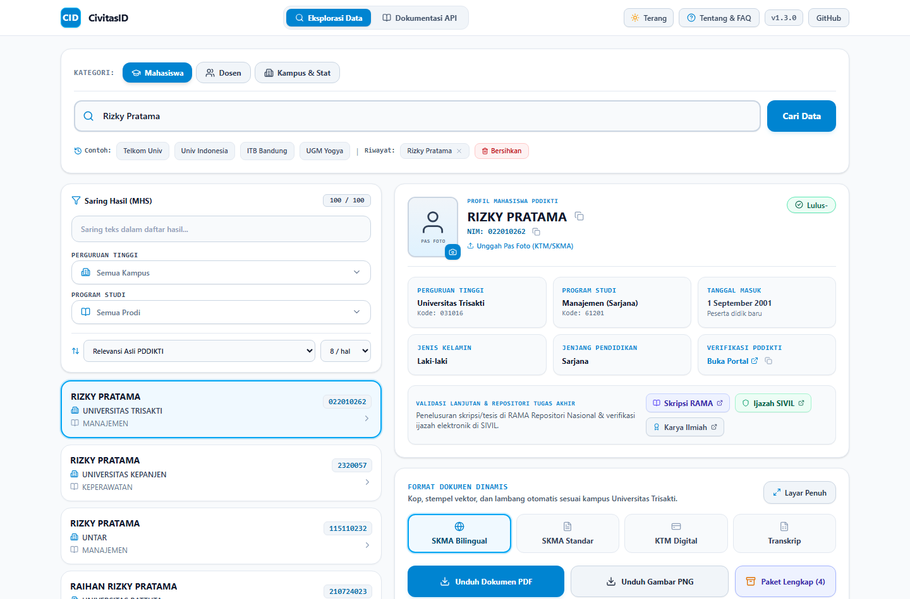
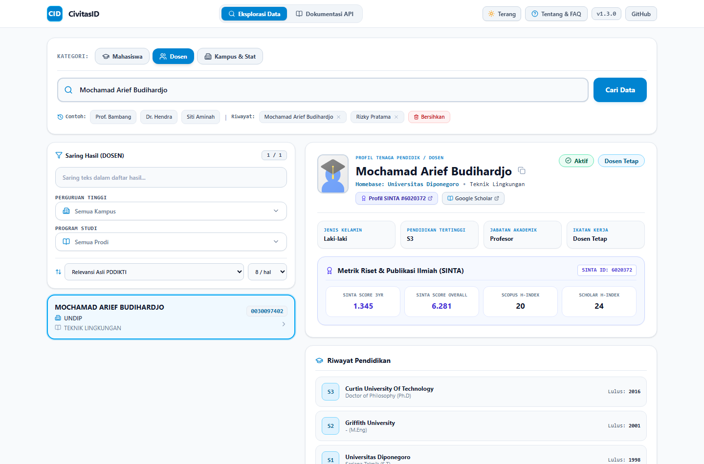
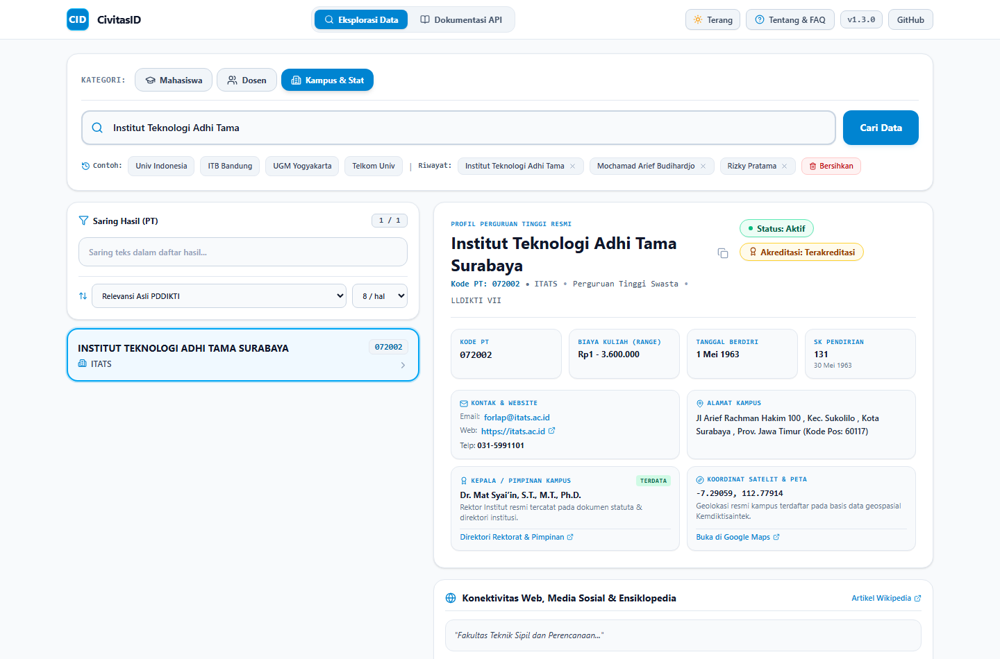
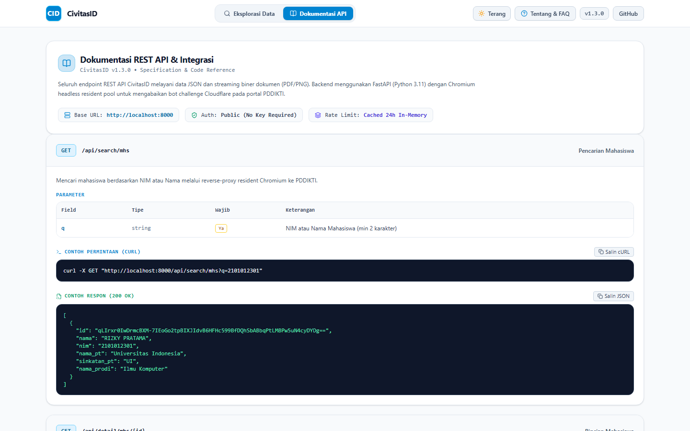
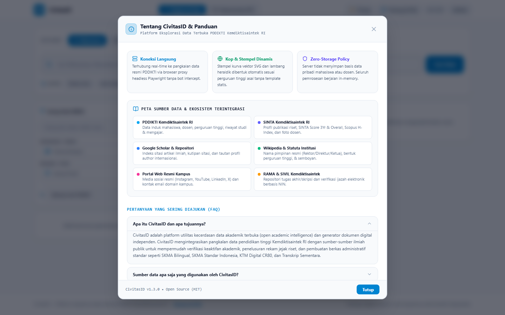
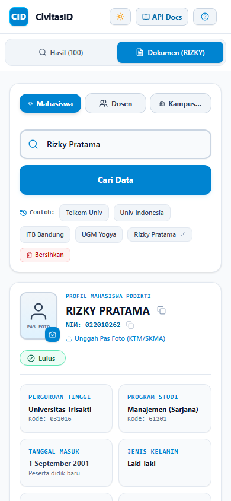

# CivitasID

<div align="center">

[](LICENSE)
[](https://python.org)
[](https://fastapi.tiangolo.com)
[](https://svelte.dev)
[](https://tailwindcss.com)
[](https://playwright.dev)

**Open Academic Intelligence Suite, Multi-Entity Data Explorer, and Dynamic Academic Document Engine for Indonesia's Higher Education Ecosystem.**

[Fitur](#fitur-utama) • [Sumber Data & Ekosistem](#sumber-data--ekosistem-terintegrasi) • [Matriks Cakupan Data](#matriks-cakupan-data-yang-diambil) • [Tangkapan Layar](#tangkapan-layar--showcase) • [Arsitektur](#arsitektur-sistem) • [Panduan Instalasi](#panduan-instalasi--menjalankan) • [Dokumentasi API](#spesifikasi-rest-api) • [Telegram Bot](#integrasi-telegram-bot) • [Kebijakan Privasi & Disclaimer](#kebijakan-privasi--batasan-tanggung-jawab)

</div>

---

## Ringkasan Proyek

**CivitasID** adalah platform sumber terbuka (*open-source*) modern yang dirancang untuk mengeksplorasi, memvalidasi, dan menyajikan kecerdasan data pendidikan tinggi secara terbuka, transparan, dan terstandarisasi.

CivitasID tidak hanya menghubungkan pengguna ke pangkalan data resmi **PDDIKTI Kemdiktisaintek RI**, melainkan juga memadukan 7 ekosistem data ilmiah nasional dan internasional untuk menyajikan profil akademik yang utuh dan terverifikasi:

1. **Eksplorasi Multi-Kategori 360°**: Mahasiswa (status & riwayat), Dosen (jabatan, mengajar & skor publikasi SINTA), serta Perguruan Tinggi (akreditasi, rektor, media sosial resmi, koordinat satelit GPS, biaya SPP, dan daftar prodi lengkap).
2. **Mesin Dokumen Akademik Prosedural**: Membangun Surat Keterangan Mahasiswa Aktif (SKMA Standar & Bilingual), Kartu Tanda Mahasiswa (KTM) Digital dua sisi berstandar ISO CR80 dengan pas foto, dan Transkrip Sementara dalam format **PDF A4** serta **PNG** resolusi tinggi.
3. **Kop Surat & Stempel Vektor Universal**: Kop institusi, stempel melingkar dekanat (<textPath> SVG), dan lambang resmi dirender secara dinamis untuk seluruh perguruan tinggi di Indonesia tanpa template statis.
4. **Anti-Bot Cloudflare Bypass Resident Pool**: Menggunakan instans Chromium headless resident yang andal untuk mengeksekusi query langsung dalam konteks web resmi tanpa risiko terblokir sistem proteksi WAF.
5. **Kebijakan Nol Penyimpanan (Zero-Storage Policy)**: Menjamin perlindungan data pribadi sesuai UU PDP No. 27/2022 tanpa penyimpanan basis data permanen di sisi server.

---

## Sumber Data & Ekosistem Terintegrasi

CivitasID menggabungkan 7 pangkalan data dan sumber informasi resmi publik:

| No | Pangkalan Data / Sumber | Domain / Akses | Peran & Kontribusi Data |
| :-: | :--- | :--- | :--- |
| **1** | **PDDIKTI Kemdiktisaintek RI** | `pddikti.kemdiktisaintek.go.id` | **Data Induk Nasional**: Biodata akademik mahasiswa, NIDN dosen, kurikulum, riwayat studi, aktivitas mengajar per semester, kode prodi, dan rasio dosen-mahasiswa. |
| **2** | **SINTA Kemdiktisaintek RI** | `sinta.kemdiktisaintek.go.id` | **Metrik Riset & Foto Dosen**: SINTA ID terverifikasi, SINTA Score 3Yr & Overall, Scopus H-Index, WoS H-Index, dan foto profil author resmi. |
| **3** | **Google Scholar** | `scholar.google.com` | **Indeks Sitasi & Profil Riset**: Jumlah kutipan publikasi, user citation ID, dan penelusuran artikel ilmiah mahasiswa & dosen. |
| **4** | **Wikipedia Indonesia & Wikidata** | `id.wikipedia.org` | **Statuta & Pimpinan Kampus**: Nama Rektor/Direktur/Ketua resmi, jenis perguruan tinggi (PTN-BH, BLU, PTS), tahun pendirian, dan semboyan/motto institusi. |
| **5** | **Portal Web Resmi Institusi** | Domain `.ac.id` / Web Resmi PT | **Konektivitas Kampus**: Tautan media sosial resmi (Instagram, YouTube, LinkedIn, X/Twitter) dan alamat email domain institusi. |
| **6** | **RAMA Kemdiktisaintek RI** | `rama.kemdiktisaintek.go.id` | **Repositori Tugas Akhir**: Penelusuran naskah skripsi, tesis, dan disertasi mahasiswa se-Indonesia. |
| **7** | **SIVIL Kemdiktisaintek RI** | `ijazah.kemdiktisaintek.go.id` | **Verifikasi Ijazah Nasional**: Validasi legalitas ijazah secara elektronik berbasis Nomor Ijazah Nasional (NIN). |

---

## Matriks Cakupan Data yang Diambil

Berikut adalah rincian data yang diproses dan disajikan oleh CivitasID:

### 1. Entitas Mahasiswa
* **Identitas Pokok**: Nama Lengkap, Nomor Induk Mahasiswa (NIM), Jenis Kelamin (`L`/`P`), Jenjang Studi (`D3`, `D4`, `S1`, `S2`, `S3`).
* **Status Akademik**: Perguruan Tinggi Asal, Program Studi, Status Keaktifan (`Aktif`, `Lulus`, `Keluar`, `Cuti`), Tanggal Masuk, Jalur Pendaftaran (Peserta didik baru / Pindahan).
* **Validasi & Luaran Ilmiah**: Tautan verifikasi langsung PDDIKTI, jalan pintas pencarian naskah skripsi di repositori RAMA, validasi ijazah SIVIL, dan pencarian karya ilmiah di Google Scholar.
* **Pas Foto Formal**: Fitur unggah foto lokal di browser untuk disematkan langsung ke dalam dokumen KTM Digital dan SKMA (disertai siluet cerdas berbasis gender jika belum diunggah).

### 2. Entitas Dosen (Tenaga Pendidik)
* **Identitas & Homebase**: Nama Lengkap beserta Gelar Akademik, NIDN / NUPTK, Perguruan Tinggi Homebase, Program Studi, Status Aktivitas (`Aktif`, `Tugas Belajar`, dll.), dan Ikatan Kerja (`Dosen Tetap` / `Dosen Tidak Tetap`).
* **Jabatan & Fungsional**: Jabatan Fungsional Akademik (Asisten Ahli, Lektor, Lektor Kepala, Guru Besar / Profesor) dan Pendidikan Tertinggi.
* **Rekam Jejak Pendidikan**: Daftar riwayat perguruan tinggi asal studi lanjut, program studi, jenjang, gelar yang diperoleh, dan tahun kelulusan.
* **Aktivitas Mengajar**: Tabel riwayat pengajaran per semester (semester, kode mata kuliah, nama mata kuliah, kelas ajar, dan perguruan tinggi penyelenggara).
* **Metrik Riset & Foto Asli**: Foto profil asli author dari pangkalan data riset, SINTA Author ID, SINTA Score 3Yr & Overall, Scopus H-Index, Google Scholar H-Index, dan tautan langsung ke profil publikasi.

### 3. Entitas Perguruan Tinggi (Kampus & Statistik)
* **Legalitas & Kelembagaan**: Nama Resmi Perguruan Tinggi, Nama Singkat/Akronim, Kode PT Resmi, Wilayah LLDIKTI (I s/d XVII), Status Akreditasi Institusi (Unggul / A / Baik Sekali / Terakreditasi), Tanggal Berdiri, dan Nomor SK Pendirian.
* **Kepemimpinan Institusi**: Nama Rektor / Direktur / Pimpinan resmi dari dokumen statuta institusi dan direktori perguruan tinggi.
* **Finansial & Waktu Studi**: Estimasi rentang biaya kuliah (SPP) per semester serta rata-rata masa studi kelulusan per jenjang (`S1`, `S2`, `D3`).
* **Rasio Akademik**: Rasio aktif dosen terhadap mahasiswa dan total pendidik aktif per semester pelaporan.
* **Daftar Program Studi Lengkap**: Tabel interaktif seluruh program studi aktif maupun tutup, dilengkapi kode prodi, jenjang, status akreditasi BAN-PT/LAM, jumlah dosen ber-NIDN/NIDK, jumlah mahasiswa, rasio spesifik prodi, serta fitur filter pencarian dan paginasi.
* **Kontak & Geospasial**: Alamat kampus lengkap, kode pos, telepon, fax, email resmi, situs web resmi, tautan media sosial resmi (Instagram, YouTube, LinkedIn, X/Twitter), serta koordinat satelit GPS (Latitude, Longitude) dengan tombol 1-klik buka di Google Maps.
* **Sarana Prasarana & Histori**: Daftar fasilitas kampus terverifikasi (sarpras) dan catatan riwayat perubahan nomenklatur perguruan tinggi.

---

## Tangkapan Layar / Showcase

### 1. Eksplorasi Mahasiswa, Pas Foto Uploader & Generator Dokumen Dinamis
Antarmuka default mode terang berstandar akademis dengan kontras tinggi, filter Select2 instan, preset kampus populer, fitur pas foto lokal, dan generator dokumen digital live.



---

### 2. Profil Dosen (Lengkap dengan Foto Asli SINTA, Metrik Riset & Riwayat Mengajar)
Sinkronisasi profil author SINTA Kemdiktisaintek secara otomatis menampilkan foto profil, SINTA ID, skor publikasi 3 tahun/kumulatif, Scopus H-Index, serta riwayat pendidikan dan aktivitas mengajar per semester.



---

### 3. Profil Perguruan Tinggi (Pimpinan Rektor, Media Sosial, GPS & Tabel Prodi Lengkap)
Menampilkan data komprehensif perguruan tinggi: Rektor terdata, akun media sosial resmi institusi, koordinat satelit GPS, rasio dosen:mahasiswa, masa studi, tabel program studi dengan pencarian prodi, dan fasilitas sarpras.



---

### 4. Dokumentasi REST API Interaktif & Panel Tentang / FAQ
Tersedia tab dokumentasi REST API interaktif bawaan dengan cuplikan cURL instan, skema payload, penjelasan status code, dan panel FAQ dengan arsitektur transparan.

| Dokumentasi REST API Interaktif | Tentang CivitasID & Panduan FAQ |
| :---: | :---: |
|  |  |

---

### 5. Desain Responsif Ponsel (Mobile Experience)
Antarmuka disesuaikan dengan ergonomi layar sentuh ponsel (minimum target sentuh 44px, bottom sheet layout, navigasi tab ringkas, dan kontras tinggi).

<div align="center">
  
</div>

---

## Fitur Utama

- **Pencarian Multi-Entitas**:
  - **Mahasiswa**: Filter berdasarkan Nama atau NIM, nama kampus, dan program studi.
  - **Dosen**: Filter berdasarkan Nama atau NIDN, prodi pangkal (*homebase*), dan status keaktifan.
  - **Perguruan Tinggi**: Informasi akreditasi, wilayah LLDIKTI, rasio dosen terhadap mahasiswa, serta kontak dan alamat kampus.
- **Mesin Dokumen Akademik 100% Dinamis**:
  - `SKMA Bilingual`: Format dua bahasa (Inggris - Indonesia) yang dirancang khusus untuk keperluan beasiswa, verifikasi platform internasional, GitHub Student Developer Pack, dan SheerID.
  - `SKMA Standar Indonesia`: Format surat resmi dekanat/fakultas sesuai tata naskah dinas universitas.
  - `KTM Digital ISO CR80`: Kartu identitas standar dua sisi (85.6mm × 54mm) dilengkapi Barcode Code128, QR Code verifikasi PDDIKTI, dan pas foto formal.
  - `Transkrip Akademik Sementara`: Rekapitulasi nilai kumulatif, distribusi SKS semester, dan indeks prestasi kumulatif (IPK).
- **Mesin Stempel & Kop Prosedural (`university_resolver`)**:
  - Mengambil nama perguruan tinggi dari data live PDDIKTI.
  - Menghasilkan SVG stempel dinamis dengan teks melingkar universitas, lambang resmi, tanda tangan dekanat digital, dan stempel bergradasi tinta stempel basah.
  - Menerapkan palet warna primer/sekunder khas kampus secara otomatis.
- **In-Memory TTL Caching**:
  - Hasil pencarian dan profil detail disimpan dalam cache memori lokal (TTL 24 jam) untuk efisiensi transfer data dan latensi respon `< 5ms` pada query berulang.
- **Riwayat Pencarian Lokal & Fitur Pembersihan 1-Klik**:
  - Riwayat query tersimpan di `localStorage` peramban pengguna untuk akses kilat.
  - Tombol **Bersihkan** untuk menghapus seluruh jejak riwayat secara instan demi menjaga privasi perangkat bersama.

---

## Arsitektur Sistem

```
┌────────────────────────────────────────────────────────┐
│                   CLIENT INTERFACES                    │
│   Web SPA (Svelte 5 + Tailwind)  | Telegram Bot (aiogram)│
└───────────────────────────┬────────────────────────────┘
                            │ REST JSON & Multipart
┌───────────────────────────▼────────────────────────────┐
│                    FASTAPI BACKEND                     │
│   • Multi-Entity Router (/mhs, /dosen, /pt)            │
│   • Academic Enrichment Service (SINTA, Wiki, Web)     │
│   • Document Render Router (/generate/pdf, /png)       │
│   • In-Memory TTL Cache Manager (24 Jam)               │
│   • Dynamic University Resolver (Procedural SVG/Crest) │
└─────────────┬───────────────────────────┬──────────────┘
              │                           │
┌─────────────▼──────────────┐ ┌──────────▼──────────────┐
│   RESIDENT CHROMIUM POOL   │ │    DOCUMENT RENDERER    │
│  (Cloudflare WAF Bypasser) │ │ (Playwright Headless    │
│  • page.evaluate(fetch)    │ │  Print Background Engine│
│  • Session Auto-Recovery   │ │  A4 PDF & High-Res PNG) │
└────────────────────────────┘ └─────────────────────────┘
```

---

## Panduan Instalasi & Menjalankan

### Prasyarat Lingkungan
- **Python**: Versi 3.10 atau lebih baru
- **Node.js**: Versi 18.x atau lebih baru (disertai `npm` atau `pnpm`)
- **Browser Runtime**: Chromium (terpasang via Playwright CLI)

---

### Cara A: Menjalankan dengan Docker Compose (Direkomendasikan)

Deployment menyeluruh (Backend, Renderer Chromium, Frontend) dapat dijalankan dalam satu perintah:

```bash
# Clone repository
git clone https://github.com/your-username/civitas-id.git
cd civitas-id

# Jalankan seluruh service dalam mode detached
docker compose up -d --build
```

Setelah kontainer berjalan:
- Antarmuka Web: `http://localhost:5173`
- Backend API & Dokumentasi Swagger: `http://localhost:8000/docs`

---

### Cara B: Menjalankan Manual di Lingkungan Lokal

#### 1. Setup Backend (FastAPI & Playwright)

```bash
cd backend

# Buat virtual environment
python -m venv venv

# Aktivasi virtual environment:
# Windows (PowerShell):
.\venv\Scripts\Activate.ps1
# Linux/macOS:
source venv/bin/activate

# Install dependensi Python
pip install -r requirements.txt

# Install binary runtime Chromium untuk Playwright
playwright install chromium

# Salin konfigurasi environment
cp .env.example .env

# Jalankan backend server
uvicorn app.main:app --host 127.0.0.1 --port 8000 --reload
```

#### 2. Setup Frontend (Svelte 5)

Buka terminal baru:

```bash
cd frontend

# Install dependensi Node.js
npm install

# Jalankan development server
npm run dev
```

Buka peramban pada alamat `http://localhost:5173`.

---

## Integrasi Telegram Bot

CivitasID dilengkapi bot Telegram interaktif berbasis `aiogram v3` yang mampu mencari data dan mengirimkan berkas PDF dokumen langsung ke ruang obrolan Telegram.

### Konfigurasi Token Bot
1. Buat bot baru melalui [@BotFather](https://t.me/BotFather) di Telegram dan catat API Token yang diberikan.
2. Edit file `backend/.env`:
   ```env
   ENABLE_TELEGRAM_BOT=true
   TELEGRAM_BOT_TOKEN="123456789:ABCdefGhIJKlmNoPQRstuVWXyz"
   ```

### Menjalankan Bot
- **Otomatis**: Bot akan otomatis menyala di background saat server FastAPI dijalankan jika `ENABLE_TELEGRAM_BOT=true`.
- **Standalone CLI**:
  ```bash
  cd backend
  python -m app.bot.telegram_service <TOKEN_BOT_ANDA>
  ```

---

## Spesifikasi REST API

Dokumentasi interaktif OpenAPI / Swagger UI tersedia secara lokal di `http://127.0.0.1:8000/docs`.

### Ringkasan Endpoint

| Method | Endpoint | Keterangan |
| :--- | :--- | :--- |
| `GET` | `/api/search/mhs` | Mencari data mahasiswa berdasarkan NIM atau Nama (`?q=`) |
| `GET` | `/api/search/dosen` | Mencari data dosen berdasarkan NIDN atau Nama (`?q=`) |
| `GET` | `/api/search/pt` | Mencari profil perguruan tinggi berdasarkan Nama atau Kode (`?q=`) |
| `GET` | `/api/detail/mhs/{id}` | Mengambil profil mahasiswa, riwayat studi, tautan RAMA & SIVIL |
| `GET` | `/api/detail/dosen/{id}` | Mengambil data dosen terintegrasi foto SINTA, skor publikasi, & riwayat mengajar |
| `GET` | `/api/detail/pt/{id}` | Mengambil data kampus lengkap: Rektor, Media Sosial, GPS, dan Program Studi |
| `POST` | `/api/generate/pdf` | Merender dan mengunduh dokumen akademik dalam format PDF A4 |
| `POST` | `/api/generate/png` | Merender dokumen akademik dalam format gambar PNG resolusi tinggi |

---

## Kebijakan Privasi & Batasan Tanggung Jawab

### Kepatuhan terhadap UU Pelindungan Data Pribadi (UU PDP No. 27/2022)
> 1. **Zero-Storage Policy**: Server CivitasID tidak pernah mencatat, mengumpulkan, atau memperjualbelikan basis data pribadi mahasiswa, dosen, maupun perguruan tinggi. Seluruh data diproses secara in-memory untuk rendering berkas dan dilindungi kebijakan sesi sementara.
> 2. **Perlindungan Kontak Privat**: CivitasID secara tegas **tidak mengambil dan tidak mempublikasikan** nomor telepon seluler maupun email pribadi mahasiswa. Hal ini sesuai dengan mandat perlindungan data pribadi spesifik dalam UU PDP guna mencegah penyalahgunaan data, telemarketing ilegal, dan kejahatan siber.

### Batasan Tanggung Jawab (*Legal & Academic Disclaimer*)
> 1. CivitasID adalah proyek utilitas independen dan **tidak berafiliasi** secara resmi dengan Kementerian Pendidikan Tinggi, Sains, dan Teknologi RI ataupun pengelola resmi PDDIKTI.
> 2. Semua data yang disajikan diperoleh secara langsung dari indeks publik terbuka PDDIKTI, SINTA, Google Scholar, dan Wikipedia.
> 3. Dokumen digital (SKMA, KTM, Transkrip) yang dihasilkan oleh sistem ini merupakan dokumen simulasi akademik (*preview / mock representation*) untuk keperluan verifikasi administratif non-formal atau pembuktian status mahasiswa aktif pada platform mitra. Dokumen ini **bukan dokumen resmi berkekuatan hukum** pengganti surat yang diterbitkan langsung oleh Biro Administrasi Akademik atau Dekanat Perguruan Tinggi yang bersangkutan. Pengguna bertanggung jawab penuh atas pemanfaatan dokumen yang dihasilkan.
